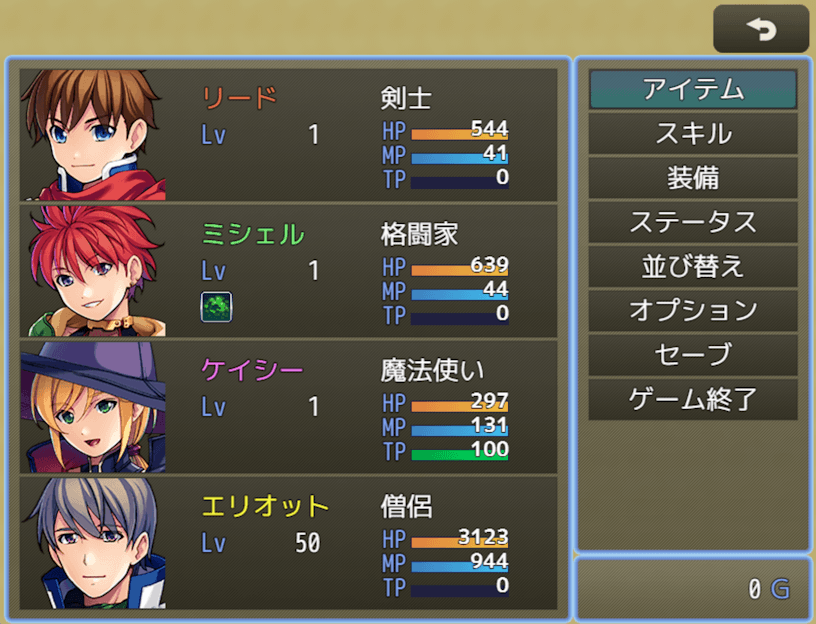
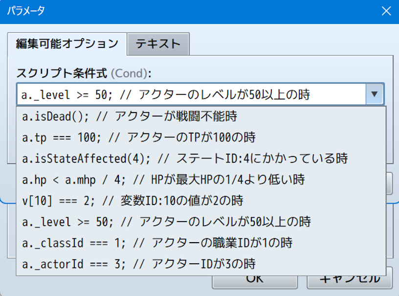

# アクター名色変更プラグイン（NLM_ActorNameColor.js）
### RPGツクールMZ/MV両用プラグイン

　メニュー/戦闘画面のアクター名の色を、スクリプト条件式により自由に変更します  
　ステート・レベル・TP・職業などの条件変化で色を変えられます

スクリプト条件式については、コンボボックスに凡例も少し用意したので参考にしてみて下さい

　パラメータ「条件と色設定リスト」は上から順に判定され、条件を満たすと色が変更されるので、それより下の条件式が無効になります  
　優先度の高い条件式は、なるべく上に配置するようにして下さい  
　リストは右クリックで「削除」「コピー」のほか、ドラッグ＆ドロップも可能です  

# download

プラグインの download は、[右クリック「名前を付けてリンク先を保存」](https://raw.githubusercontent.com/nolimits-tukool/NLM_ActorNameColor/refs/heads/main/NLM_ActorNameColor.js)  
RPGツクールMZ/MV両用です

Windows11の[「スマートアプリコントロール」でブロックされる場合](https://github.com/nolimits-tukool/HandlingSmartAppControl)

# license

　MITライセンスの通りです

## [リポジトリ 一覧へ](https://github.com/nolimits-tukool?tab=repositories)
